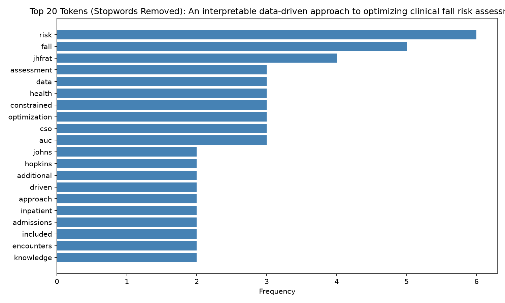
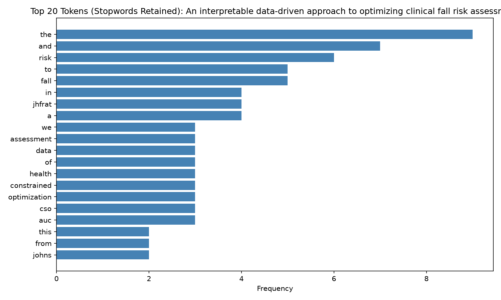
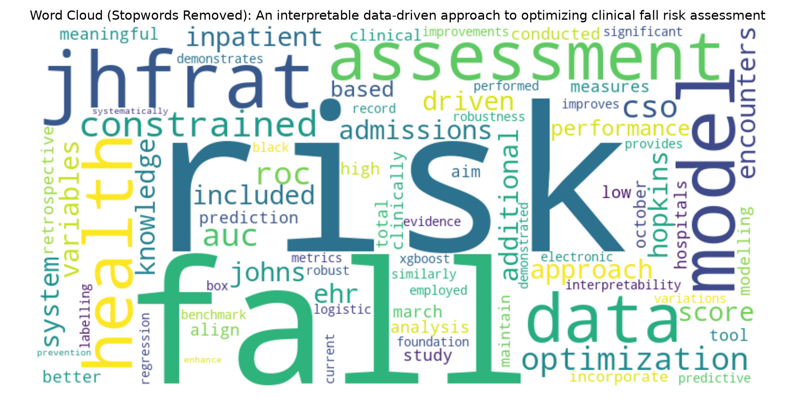
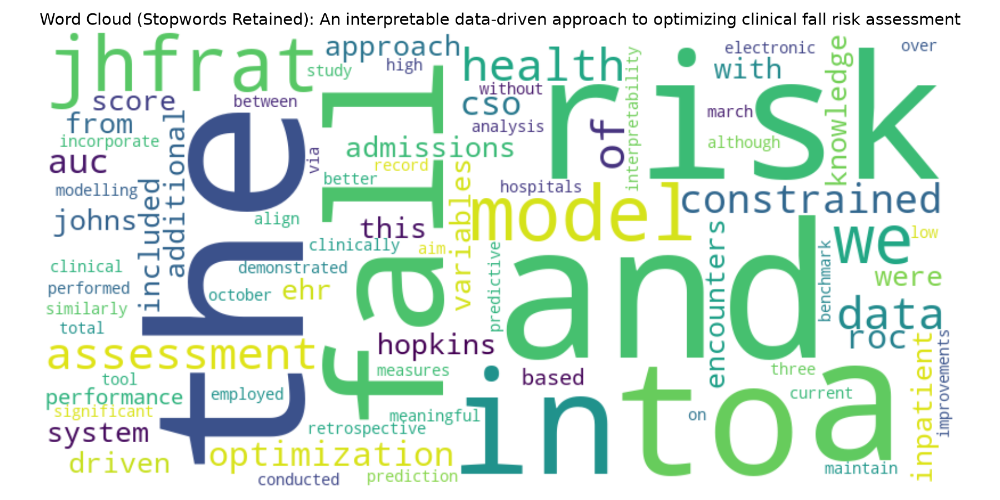

# Web Mining and Applied NLP Project Report

Web Mining and Applied NLP | Project 06 | Beth Spornitz | November 2026

## Overview

This project implements a natural language processing (NLP) pipeline for analyzing text extracted from web documents.

The project extends the earlier EVTL architecture by introducing an Analyze stage.

## Tools and Methods

The project uses:

- Python for pipeline orchestration and processing.
- Requests for retrieving HTML documents.
- BeautifulSoup for parsing and extracting HTML content.
- spaCy for tokenization and linguistic text processing.
- Pandas for structured data transformation.
- Token counts and type-token ratios for describing vocabulary.
- Matplotlib for token frequency visualizations.
- WordCloud for visual exploration of vocabulary.
- CSV for persistent output.
- Logging for execution records.
- Ruff, ty, and pytest for code verification.
- Zensical and GitHub Pages for published documentation.

The pipeline implements five stages:

- **Extract** - retrieve HTML and preserve the raw document.
- **Validate** - verify the expected HTML structure.
- **Transform** - extract metadata, clean text, and engineer NLP features.
- **Analyze** - compute token frequencies and create visualizations.
- **Load** - save the processed dataset to a CSV file.

The Transform stage uses spaCy with the `en_core_web_sm` English language model.

---

## Technical Modification of the Original Pipeline (D2)

### Modification

I changed the default `top_n` parameter in `src/nlp/stage04_analyze.py` from 20 to 15 to create a more focused token frequency chart.

### Prediction

I predicted that the chart and terminal summary would display 15 tokens instead of 20, while the underlying token counts would remain unchanged.

### Results and Interpretation

The modified pipeline ran successfully, and the results matched my prediction. The original abstract still contained 177 words, 130 cleaned tokens, and 118 unique tokens, with a type-token ratio of 0.9077.

This experiment demonstrates how a small technical modification can change the presentation of results without changing the underlying data.

---

## Custom Application: Clinical Fall-Risk Assessment (D3)

### Overview and Data Source

The custom application analyzes an academic research paper about clinical fall-risk assessment and explores how stopword removal affects word frequencies, vocabulary diversity, and visualizations.

How does removing stopwords affect word frequencies, vocabulary diversity, and visualizations when analyzing a clinical research abstract?

I chose this topic because of my professional experience working with nursing quality indicators, including patient falls. I wanted to apply the NLP techniques demonstrated in the example to a topic that is relevant to my work.

The custom pipeline retrieves the abstract and associated metadata from the following academic research paper:

[An Interpretable Data-Driven Approach to Optimizing Clinical Fall Risk Assessment](https://arxiv.org/abs/2510.20714)

The paper examines a data-driven approach to improving clinical fall-risk assessment using the Johns Hopkins Fall Risk Assessment Tool and additional clinical information.

The analysis focuses on the text of the abstract, rather than the patient-level data used in the study.

### Tools and Methods

The custom application uses a separate set of Python files located in `src/nlp/custom/`.

- `config_custom.py`
- `pipeline_web_html_custom.py`
- `stage01_extract_custom.py`
- `stage02_validate_custom.py`
- `stage03_transform_custom.py`
- `stage04_analyze_custom.py`
- `stage05_load_custom.py`

The custom pipeline retains the five-stage EVTAL architecture demonstrated in the example.

The primary difference is that the custom pipeline processes the abstract using two approaches:

1. Clean and tokenize the text while removing stopwords.
2. Clean and tokenize the text while retaining stopwords.

Both approaches use the same source document, allowing the effects of stopword removal to be compared.

The pipeline calculates token counts, unique token counts, and type-token ratios for both approaches. It also creates separate token frequency charts and word clouds.

### Verification and Output Files

From the project root, run:

```bash
uv run python -m nlp.custom.pipeline_web_html_custom
```

The custom pipeline executed successfully and produced the following artifacts:

| File | Description |
| --- | --- |
| `data/raw/fall_risk_raw.html` | Original HTML document |
| `data/processed/fall_risk_processed.csv` | Processed NLP dataset containing both preprocessing approaches |
| `data/processed/fall_risk_top_tokens.png` | Token frequency chart with stopwords removed |
| `data/processed/fall_risk_top_tokens_with_stopwords.png` | Token frequency chart with stopwords retained |
| `data/processed/fall_risk_wordcloud.png` | Word cloud with stopwords removed |
| `data/processed/fall_risk_wordcloud_with_stopwords.png` | Word cloud with stopwords retained |

Copies of the four custom visualizations are included in `docs/images/` for display on the published documentation site.

The original example pipeline is retained separately from the custom application.

### Results

The original abstract contains 190 words.

The following table compares the results of the two preprocessing approaches.

| Measure | Stopwords Removed | Stopwords Retained |
| --- | ---: | ---: |
| Token count | 142 | 198 |
| Unique token count | 99 | 122 |
| Type-token ratio | 0.6972 | 0.6162 |

Removing stopwords reduces the total token count by 56 tokens, or approximately 28.3%.

The number of unique tokens also decreases, but the type-token ratio increases from 0.6162 to 0.6972.

The original word count and processed token counts are different measures because tokenization can split text into units that differ from the words counted in the original abstract.

### Token Frequency Visualizations

#### Stopwords Removed



#### Stopwords Retained



The frequency charts allow a comparison of the most frequently occurring tokens under each preprocessing approach.

### Word Cloud Visualizations

#### Stopwords Removed



#### Stopwords Retained



The word clouds provide another way to visually explore the vocabulary and compare the effects of stopword removal.

### Interpretation

The results demonstrate that preprocessing decisions can affect the outcome of an NLP analysis even when the original source document remains the same.

Removing stopwords reduces the number of tokens and increases the proportion of unique tokens relative to the total number of tokens.

This does not mean that removing stopwords creates additional vocabulary. The number of unique tokens actually decreases from 122 to 99.

When stopwords are retained, "the" and "and" are the two most frequently occurring tokens, appearing nine and seven times, respectively.

After stopword removal, "risk" becomes the most frequent token with six occurrences, followed by "fall" with five and "jhfrat" with four.

The frequencies of these clinical terms remain unchanged across both preprocessing approaches.

Nine of the top 20 tokens in the unfiltered results are stopwords. Removing these words allows other topic-related terms, such as "inpatient," "admissions," and "encounters," to appear in the top 20.

This demonstrates how stopword removal can improve the visibility of clinically relevant vocabulary without changing the frequency of retained terms.

The word clouds reinforce the findings from the token frequency charts. When stopwords are retained, common words occupy a significant portion of the visualization.

After stopword removal, terms related to clinical fall-risk assessment, prediction, and optimization become more prominent. This makes the subject of the research paper easier to identify visually.

However, stopword removal can also eliminate information that may be important for understanding the context or meaning of the text.

The appropriate preprocessing approach depends on the purpose of the analysis.

### Limitations

- The analysis uses the abstract of only one academic research paper.
- The results may not represent the vocabulary of the full article or other clinical research.
- Word frequencies do not capture the full context or meaning of individual words.
- Removing stopwords may eliminate meaningful linguistic information.
- Type-token ratios are influenced by the number of tokens and the preprocessing methods used.

### Next Steps

If I were to continue this project, I would expand the analysis to include abstracts from multiple research papers about clinical falls and patient safety.

I would also explore bigrams and other multiword expressions to identify meaningful clinical phrases, such as "fall risk" and "risk assessment," rather than analyzing each word independently.

Another possible application would be analyzing written responses from healthcare surveys to identify recurring terminology and potential themes related to patient safety.

---

## Documentation Index

- **Home** - this landing page
- [Project Instructions](project-instructions.md)
- [Glossary](glossary.md)
- [NLP Evolution](nlp-evolution.md)

## Project Links

- [Custom GitHub Repository](https://github.com/BethSpornitz/nlp-06-nlp-pipeline-custom)
- [Custom Pipeline](https://github.com/BethSpornitz/nlp-06-nlp-pipeline-custom/blob/main/src/nlp/custom/pipeline_web_html_custom.py)
- [Custom Configuration](https://github.com/BethSpornitz/nlp-06-nlp-pipeline-custom/blob/main/src/nlp/custom/config_custom.py)
- [Custom Transform Stage](https://github.com/BethSpornitz/nlp-06-nlp-pipeline-custom/blob/main/src/nlp/custom/stage03_transform_custom.py)
- [Custom Analyze Stage](https://github.com/BethSpornitz/nlp-06-nlp-pipeline-custom/blob/main/src/nlp/custom/stage04_analyze_custom.py)
- [Original Instructor Repository](https://github.com/denisecase/nlp-06-nlp-pipeline)

## Project Resources

- [Project Instructions](project-instructions.md)
- [NLP Evolution](nlp-evolution.md)
- [Professional Python Guide](https://denisecase.github.io/pro-analytics-02/)
- [Professional Python Project Explainer](https://pup-pack.github.io/professional-python-project-explainer/)

## Acknowledgments

This project is based on the original example developed by Dr. Denise Case for Web Mining and Applied NLP.

The custom clinical fall-risk application and stopword comparison were developed by Beth Spornitz.
